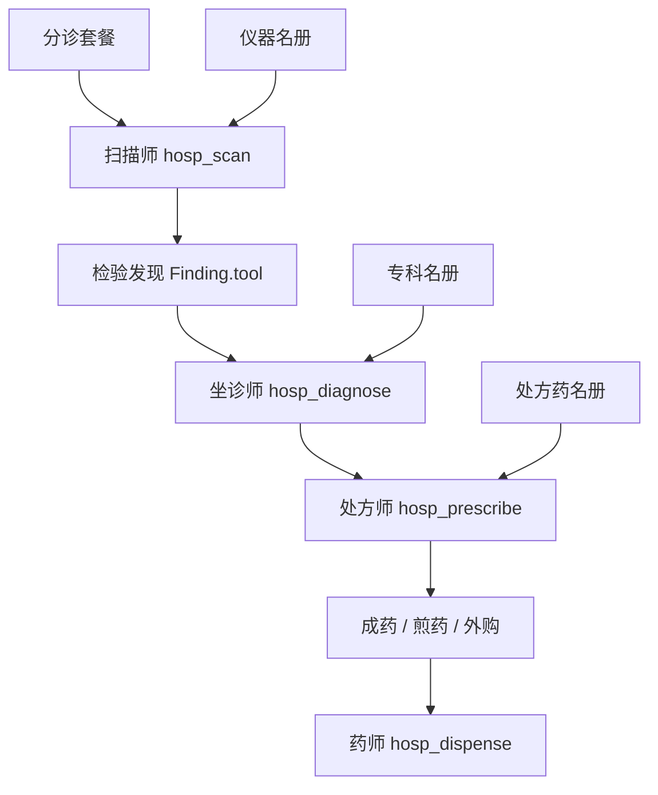
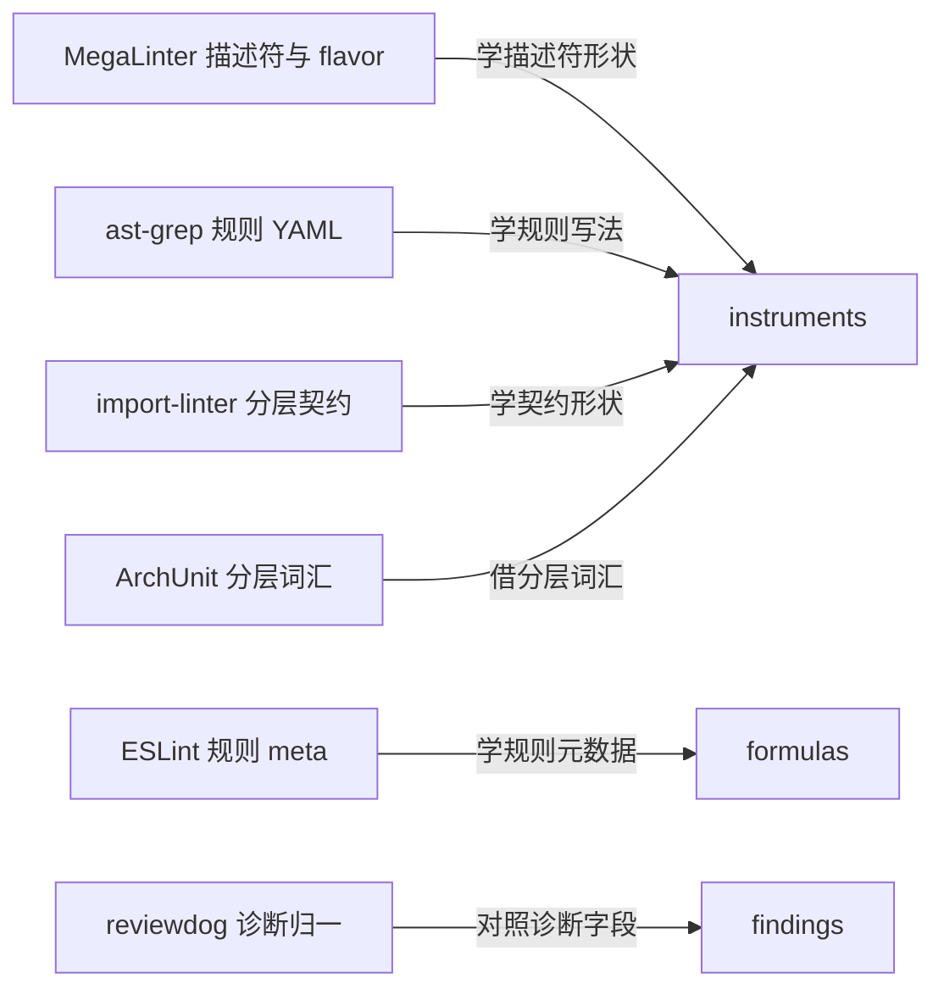
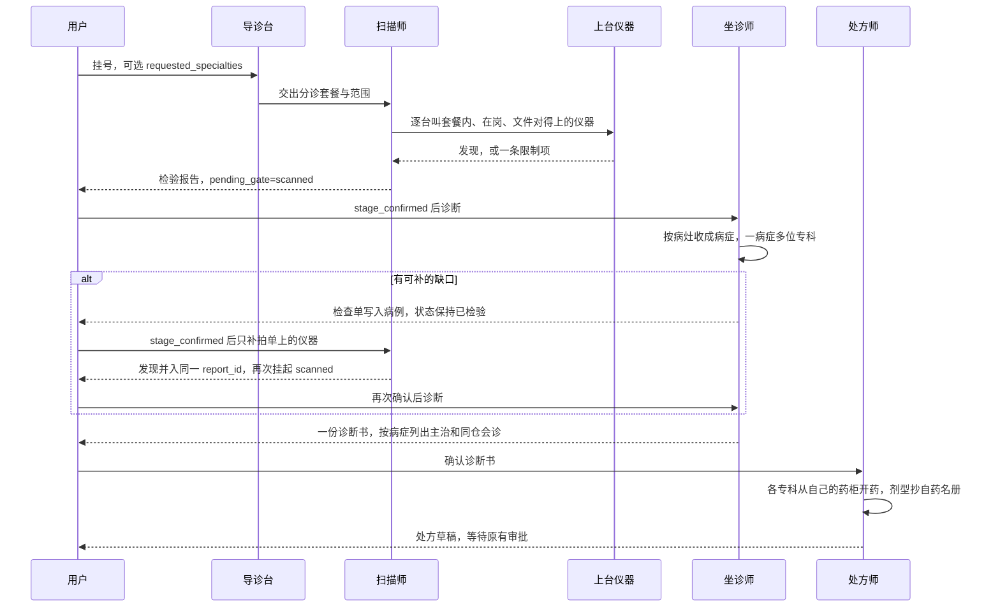
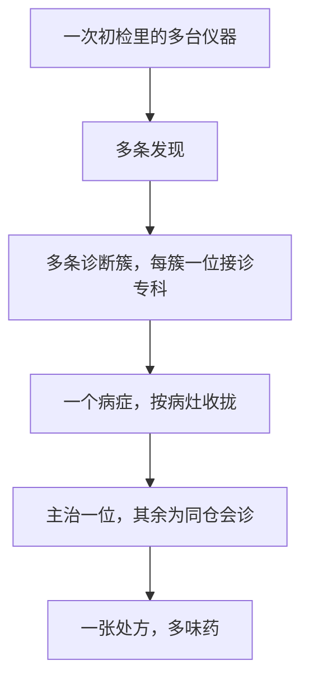
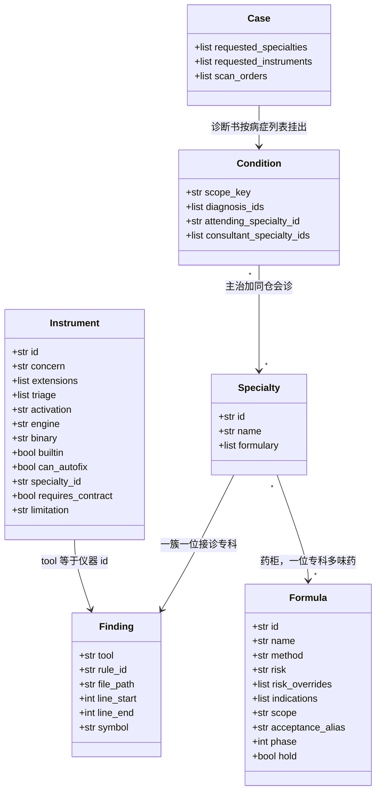

# 代码医院 · 内置名册（专科、处方药、检验仪器）

> 状态：名册已由运行时读取。第一期已接入分流、药柜、结构尺（lizard 在岗时含圈复杂度）、检查单、`scope_lines`、java-pack、hotspot-ruler、分层尺、ESLint 成药（可修规则开清创）、jscpd 去重，以及点名后的类型尺（mypy 或 pyright）。`hosp_treat` 自动档会串起这一整条路径。正骨仍是第二期。不改病例状态机。
> 上位设计见 [`code-hospital-design.md`](./code-hospital-design.md)（原则 7「能力挂流程，不乱设科室」，以及 §7 已采纳的开源零件）。本文把会诊专科、处方药、检验仪器收成三本名册，并给出同类开源项目的参考、搬迁、复用判断。

---

## 1. 设计目标与定位

### 1.1 核心定位

名册是诊疗执行层里的**临床路径数据**。扫描师按名册挑仪器拍片，坐诊师按名册请专科读片。每位专科带着自己的药柜出诊，处方师按这次发现的适应证从柜里选药，药再落到现有的三种剂型：成药（`autofix`）、煎药（`llm_patch`）、外购（`manual`）。

它解决三件已经在对话里定下来的事：

| 需求 | 名册里的落点 |
|---|---|
| 架构、设计、长函数、Java、Python、性能要有内置医生 | 专科名册。医生是诊断时的会诊身份，写进诊断书 |
| 重构以及清创、拆分、改名等要有内置药 | 处方药名册。药是配方，写进处方项，执行仍走三种剂型 |
| 不同仪器的关注点不同 | 仪器名册。每台仪器声明关注点、认哪些文件、哪级分诊上台、发现交给哪位专科 |

框架（Spring、Django）放进对应语言的规则包，不单独立专科。重构是药，长函数和长文件是病。

### 1.2 设计原则

1. **名册是数据，流程是现成的。** 三份名册随包携带，由 `hosp_scan`、`hosp_diagnose`、`hosp_prescribe` 读取。工具数量与病例状态机保持不变。接入时要加的入参和出参只在第 6 节升版，不在本文件里改契约。
2. **仪器只拍片。** 仪器读代码、出 `Finding`。`Finding.tool` 记下仪器 id，引擎名写在仪器名册的 `engine`，不写进发现。确认、会诊、改代码仍走阶段门禁和处方审批。
3. **缺设备要写进限制项。** 二进制不在 PATH、范围内没有对得上的文件、仓库没写分层约定、专科第一期没有仪器，都记入检验报告的限制项。这种片子标成「未拍到」，不当成全正常。其中 PATH 缺失、无适配文件、无契约、无仪器是终态限制，不再开检查单。
4. **无契约不判架构违规。** 分层、依赖方向以仓库自己声明的契约为准。医院不替仓库发明一套分层。多份契约同时存在时只采用优先级最高的一份，顺序见 §4.4。`catalog.layers` 排在 import-linter、ArchUnit、dependency-cruiser 之后。
5. **分诊决定哪几台上台。** 急诊、门诊、体检是三套仪器组合。点名才上的仪器不进默认套餐。出院比健康时，只比较初诊和复诊都启用过的仪器交集（设计 §4.5 已有这条）。初诊补拍成功的仪器算进入院基线。
6. **主链路保持离线。** 规则随包携带。默认不在检验时访问 Semgrep Registry 这类在线规则库。
7. **许可证决定能不能进仓库。** AGPL 项目只学结构，不复制源码，也不把对方进程嵌进 `hosp serve`。LGPL、GPL 的扫描器继续进程外调用，与设计 §7 对 Semgrep、Serena 的处理一致。
8. **专科带着药柜出诊。** 药柜是多对多：一位专科可开多味药，一味药也可放进多位专科的柜子。柜子只写在 `Specialty.formulary`，药自己的条目不重复登记所属专科。开哪几味，看这条发现命中了哪些适应证。去重键是 `(formula_id, scope_key, parent_formula_id)`，伴随药用 `parent_formula_id` 区分不同主药。
9. **一个病症可以多片、多专科、多味药。** 同一病灶上的多条诊断簇收成一个病症。诊断书是病症列表，每个病症一位主治，其余为同仓会诊，药合成一张处方。每条簇仍由一位专科接诊。本文的「会诊」只指这层同仓关系，不写 `case_links(relation=consultation)`。跨仓库的病仍走设计 §4.8 的转诊单，另挂一号。
10. **剂型只由处方药名册决定。** 坐诊不再用另一张规则表判定 `autofix` / `llm_patch` / `manual`。对不上任何适应证、也不走兜底续治的簇标待复核，不入方。诊断簇上的 `fixability` 只展示该簇主项（不含伴随药）的 `method`。成药、煎药、外购的个数按处方项计，不按诊断簇计。

---

## 2. 名册架构

### 2.1 架构总览

三本名册挂在现有科室上。仪器产出发现，专科解释发现并从自己的药柜里挑药，处方师把挑中的药收成可审批的处方项。



和开源零件的对应关系：



MegaLinter 是 AGPL-3.0。箭头表示学形状或借词汇，不表示链入其源码，也不表示运行时依赖。

---

## 3. 业务流程

### 3.1 业务流程图



### 3.2 业务节点简述

1. **挂号。** 导诊台沿用现有分诊：密钥类预检倾向急诊，指定路径是门诊，全仓库是体检。`requested_specialties` 点名专科，只影响主治排序，以及该专科名下 `activation=on_request` 且绑在专科上的仪器（热点尺绑性能科）。`requested_instruments` 单独点名仪器。类型尺只认后一个入口：点了 Python 语言科不会因此跑 mypy。两个字段都不新开病例状态。定义见第 6 节，接入前调用方还不传。
2. **挑仪器。** 扫描师读仪器名册，留下同时满足四条的仪器：属于本轮套餐或被点名且 `activation=on_request`、二进制在岗或是院内自带、范围内有它认的文件、它要求的契约存在。契约、配置或第一期仪器不存在时跳过，限制项标成终态。
3. **拍片。** 同一轮里按名册逐台调用，不另做并行调度。每台仪器独立失败。一台超时或崩溃，只给自己记限制项，其他仪器的发现照常进入报告。这与现在 `AdapterError` 的行为一致。二进制不在 PATH 直接记终态限制，因为同一次就诊里再跑一遍也找不到。
4. **确认检验报告。** 仍走 `pending_gate=scanned`。名册不取消阶段门禁。
5. **会诊。** 坐诊师先按现有聚类把发现收成诊断簇。一簇对应一位接诊专科，分流表见 §4.1。然后按 §4.1.1 的病灶键把多簇收成病症。每个病症上的专科去重后，一位做主治，其余做同仓会诊。有可补缺口时先把检查单写到病例上，不写诊断书，也不进入开方。
6. **开方。** 病症上的每位专科只从自己的药柜、只为自己接诊的那些簇选药。剂型抄药名册的 `method`。一簇只有一个 `scope_key`，对应一条主药；伴随药另开，带 `parent_formula_id`。去重键是 `(formula_id, scope_key, parent_formula_id)`，主药的 `parent_formula_id` 为空。留下严重度更高的那簇；严重度相同则留主治专科开的那条，再并列则留专科 id 字典序较小的一条。高危药仍要 `approver=user` 且 `user_confirmed=true`。待复核的簇默认不入方。两条处方项在下面任一条件成立时都留下，并写 `formulary_conflict` 与 `conflict_reason`，审批前不自动删：`scope_key` 相同（`same_scope`）；同一文件的行区间相交（`overlap`）；一方的范围包住另一方（`parent_child`，例如 `#file` 或函数区间包住其中一行，或契约切块包住其中的文件）。参与冲突的两边是「先别改」（`hold=true`）对「要改」，或成药对煎药。成药先执行；煎药备料前按算法 A6 重读文件。成药必须带 `scope_lines`，执行时只保留落在这些行里的 diff。
7. **施治与出院。** 药师不认识专科，只执行已批准项的剂型。出院门禁的健康比较继续按仪器交集。入院基线取初诊这份 `report_id` 上实际跑过的仪器，含补拍成功的那几台。复诊沿用这个集合。

### 3.3 检查单与阶段门禁

检查单是病例上的 `scan_orders`：一份待补仪器清单，元素为 `{instrument_id, reason}`。它要穿过下一次工具调用，所以落在病例上。病症本身仍在诊断时现算，不另建 `conditions` 表。

`auto_advance=false` 时的顺序：

1. 初检 `hosp_scan` 在 `scan_orders` 为空时按套餐跑。发现写入新的 `report_id`，`round` 仍为 1。结束时 `status=scanned`，`pending_gate=scanned`。
2. 用户带 `stage_confirmed=true` 调用 `hosp_diagnose`，且当时 `scan_orders` 为空。没有可补缺口时直接写诊断书，规则同下面第 5 步。有可补缺口时，把清单写入 `scan_orders`，**不**插入诊断行，**不**写诊断报告，**不**把 `status` 改为 `diagnosed`。`pending_gate` 设回 `scanned`。同一时刻写一条护理记录，`event=scan_order_issued`，正文是仪器 id 和 reason。返回这份清单。
3. 清单已存在时再次调用 `hosp_diagnose`，原样返回清单，不追加、不落诊断书。
4. 用户带 `stage_confirmed=true` 调用 `hosp_scan`，且 `scan_orders` 非空。只跑清单里现在能上台的仪器，不重跑本轮已经成功的仪器。新发现的 `report_id` 仍用初检那条，不新开 `round`。初检 Markdown（`scan-r1.md`）原文保留。另写 `scan-r1-supplement.md`，只记本轮新增发现和限制项。`reports` 增加一行 `stage=scan_supplement`。然后清空 `scan_orders`。这一轮仍失败的仪器改为终态限制。`pending_gate` 再次设为 `scanned`。
5. 用户再次确认后调用 `hosp_diagnose`。此时清单已空，才写诊断书，`status=diagnosed`，`pending_gate=diagnosed`。片子仍缺的部分留在限制项里，已有发现照常入书。

一次就诊只补拍一轮。补拍之后不再根据同一类缺口开第二张检查单。

会进入 `scan_orders` 的只有两类：

| 缺口 | reason | 例子 |
|---|---|---|
| 点名了 `activation=on_request` 的专科，前置条件满足，这台仪器本轮还没跑 | `requested:<specialty_id>` | 点了性能科，热点尺尚未拍 |
| 套餐内仪器二进制在岗，但本轮超时或崩溃 | `retry:<instrument_id>` | ruff 在 PATH 里，扫描超时 |

立即写成终态限制、不进检查单的情况：二进制不在 PATH；范围内没有它认的文件；要求契约或项目配置而仓库没有；专科第一期没有仪器；`on_request` 且本轮没有点名。点了架构科但仓库没有分层契约，限制项写「未配置分层，分层尺未拍」，到此为止。点了设计科，限制项写「设计科第一期无检验仪器」，到此为止。类型尺、热点尺没被点名时保持关闭，不因为 Python 语言科或结构科已经接诊就把它们排进检查单。

`auto_advance=true` 时全程不设 `pending_gate`。初检结束后若清单非空，`hosp_treat` 在同一次编排里再扫一轮清单，然后诊断。这一轮仍开不出的仪器改为终态，不空转。

---

## 4. 核心设计

### 4.1 三本名册怎么咬合

一条发现的路径是：

`仪器 id（Finding.tool） + rule_id → 一位接诊专科 → 该专科药柜里适应证命中的药 → 药上的 method`

`Finding.tool` 就是仪器 id。`java-pack`、`hotspot-ruler` 即使引擎是 semgrep，`tool` 也写仪器 id，不写 `semgrep`。引擎名只放在仪器的 `engine` 字段。已经在岗的三台 id 保持 `ruff`、`semgrep`、`gitleaks`，现有发现不用改写。

分流时前缀比通配更优先。一台仪器对不上任何一行时，接诊专科记全科，再按适应证决定入不入方。有一条安全覆盖写在表前：`tool=gitleaks`，或 `severity=critical`，接诊专科改为全科，只开封存。语言科分流表不覆盖这一档，因此 ruff 的 critical 不再由 Python 语言科走煎药或待复核。

| 仪器 id（Finding.tool） | rule_id | 接诊专科 |
|---|---|---|
| ruff | `*` | python |
| semgrep | `*` | general |
| gitleaks | `*` | general |
| structure-ruler | `structure.*` | structure |
| eslint | `*` | general |
| java-pack | `java.*` | java |
| layer-ruler | `*` | architecture |
| hotspot-ruler | `hotspot.*` | performance |
| type-ruler | `*` | python |

第一期的随包 semgrep 小规则集走仪器 id `semgrep`，接全科。设计科没有仪器，也没有分流行。`java.*` 与 `hotspot.*` 必须同时出现在对应药的适应证里；对不上、又不是 critical 的，走该专科柜里的续治，不掉进出方。现行 `_judge` 到名册的对照见 §4.3.1。

这条路径描述的是**一条诊断簇**。分簇键见 §4.1.1，一个簇一个 `scope_key`、一位接诊专科。这位专科的柜子里仍可以有多味药。Python 语言科看到 `F841` 开清创，看到 `BLE001` 开补罩；补罩同时放在 Python 语言科和 Java 语言科的柜子里，谁接这簇谁开。同一个病灶上若还有别的簇，那些簇另请专科，合在 §4.1.1 的病症里一起开方。

gitleaks 的命中由全科接诊，从全科药柜里开封存，剂型是外购，`hold=true`。函数超过 80 行由结构科接诊，从结构科药柜里开拆分；拆分是煎药时，再按伴随药规则加对照。仓库写了分层契约且低层 import 了高层，由架构科接诊，从架构科药柜里开归位：不自动改代码，交接清单写明违反的是哪一条契约。

### 4.1.1 一个病症：多台仪器、多位专科、多味药

病症是同一病灶上的一组诊断簇，不是新病例，也不是新工具。跨仓库的问题仍按设计 §4.8 开转诊单，到另一个仓库挂号，不并进这个病症。

分簇改掉现在的 `group_findings`。算法 A5 的三级键与这里同时改，避免两份文档各写一套：

1. 簇的主键是 `(rule_id, scope_key)`。一个簇只有一个 `scope_key`，因此总能落进下面的一个病症。
2. `content_key` 不再参与分簇，只继续用于复发调档。
3. 同一 `formula_id`、同一 `rule_id`、`method=autofix` 的多个簇，可以在开方时收成一批执行，再按 `cluster_max_files=5` 切开。诊断书上它们仍是多簇。`method` 不一致的发现禁止合成一批。
4. 分层尺的病症按契约规则聚合，用来选主治。生成处方项时仍按文件切块，每块最多 5 个文件，`cluster_max_files` 对 `manual` 和以后的煎药同样有效。

`scope_key` 是合方、冲突和病症收拢共用的一把钥匙：

| 发现 | scope_key |
|---|---|
| `symbol` 非空 | `file:{path}#sym:{symbol}` |
| `symbol` 为空 | `file:{path}#lines:{line_start}-{line_end}` |
| 结构尺的文件行数 | `file:{path}#file` |
| 分层尺 | `contract:{contract_id}#rule:{rule_id}` |

符号为空时不退到整份文件。文件行数这条发现使用 `#file`，不把同文件的其他发现吸进来。

收成病症的规则：

1. 带符号的发现各自打开一个病灶，行区间用发现自己的 `line_start`–`line_end`。结构尺报函数超长或圈复杂度时，必须把 `symbol` 设为函数名，行区间覆盖整个函数。
2. 没有符号的发现，若同一文件里恰好有一个函数级病灶的行区间包住它，就并入那个病灶。包住它的函数级病灶有多个时，并入行区间最短的那个。函数级病灶只来自 `structure.function_lines` 和 `structure.cyclomatic`。
3. 没有函数级病灶包住它时，它自己以行区间作为病灶，不因为同文件就合并。
4. 分层尺不参与行区间合并。同一条契约规则下的全部违例文件合成一个病症，键用上表的 `contract:` 形式。`contract_id` 取实际采用的那份契约（优先级见 §4.4）。处方项不使用这把整把契约键当执行范围，而是按文件切块。

每个病症单独选主治，与别的病症无关：

1. 本症里、且出现在 `requested_specialties` 中的专科，取得严重度最高的那一位。
2. 否则取本症内严重度最高的那簇的专科。
3. 严重度相同：沿用现有诊断簇排序（严重度、类目），取排序靠前的那簇的专科。
4. 仍并列：专科 id 字典序最小的一位。

其余专科是同仓会诊，只给自己的簇写意见。一份诊断书含多个病症时，每个病症各有自己的主治和会诊名单。



三件事分开做：

| 需要 | 怎么落 | 用户看到的 |
|---|---|---|
| 多台扫描 | 初检按分诊套餐逐台调用，结果在同一份检验报告里。可补缺口按 §3.3 写入 `scan_orders` | 检查单写明仪器 id 和 reason。确认后再次 `hosp_scan`，只补这些仪器，发现并入同一 `report_id`。病例停在已检验。清单清空后才写成诊断书 |
| 多位医生 | 每个病症按本节的四步选一位主治，其余专科为同仓会诊 | 一份诊断书，里面是病症列表。每个病症有自己的主治、会诊名单，以及各簇的接诊专科 |
| 多味药 | 每位专科只开自己柜里、自己簇上命中的药。处方师合成一张处方，沿用现有的项排序。去重键是 `(formula_id, scope_key, parent_formula_id)` | 一张处方草稿。同一味药、同一个范围、同一个主药只留一条 |

`hold=true` 的药（封存、归位）与要改的药，以及成药与煎药，在 `scope_key` 相同、行区间相交、或一方包住另一方时都标 `formulary_conflict`。原因分别是 `same_scope`、`overlap`、`parent_child`。封存的键是命中行，同文件另一行且区间不相交的清创不冲突。归位按文件切块后，块内的成药或煎药标 `parent_child`。审批前不自动删，也不自动批。

例：函数 `load_report` 有 200 行。结构尺上报 `structure.function_lines`，`symbol=load_report`，行号覆盖整个函数。ruff 在函数体内报 `F841`，该行没有符号，行号落在这个函数的区间里，于是并入同一病症。按现有严重度映射，两条都是 `major`，类目序上结构簇靠前，主治是结构科，会诊是 Python 语言科。挂号时点了性能科，热点尺还没拍。检查单只补 `hotspot-ruler`（性能科的 `on_request` 仪器）。补拍有命中后，性能科加入会诊。处方里可以同时有清创、拆分、削峰；拆分和削峰是煎药，各自带一味对照，`parent_formula_id` 分别是 `split` 和 `throttle`，两条对照都留。拆分虽然在结构科和性能科柜里都有，键相同，只留一味。清创的行落在拆分的函数区间内，标 `parent_child`，两项都留。`F841` 若落在这个函数之外，它单独成症，不并进来。点名 Python 语言科不会把类型尺排进这张检查单。

### 4.2 专科名册

默认坐诊仍是全科。下表的专科只在接诊规则命中时出现在诊断书上。

接诊条件以 §4.1 的分流表为准。下表只登记药柜和第一期能不能上台。

| id | 专科 | 药柜 | 说明 |
|---|---|---|---|
| general | 全科 | 清创、补罩、封存、进货、对照、续治 | 分流表落全科，或 critical / gitleaks 覆盖到全科时接诊 |
| python | Python 语言科 | 清创、补罩、拆分、正骨、去重、对照、续治 | 接 ruff 与类型尺。能成药的规则开清创，其余非 critical 的 ruff 与类型尺发现开续治 |
| java | Java 语言科 | 补罩、拆分、正骨、去重、对照、续治 | 接 `java-pack`。`.java` 上的结构尺仍由结构科按分流表接诊。第一期没有 Java 成药执行器。对得上的规则开补罩，其余非 critical 开续治 |
| structure | 结构科 | 拆分、去重、对照 | 接结构尺。一次只动一个符号或一个文件 |
| architecture | 架构科 | 归位、拆分、进货、对照 | 只在仓库已声明契约时接诊。没有契约是终态限制 |
| design | 设计科 | 正骨、去重、拆分、对照 | 这里指软件设计。第一期没有仪器，不出现在诊断书上。点名时写终态限制，药柜留给以后的规则包。动公开 API 的正骨仍按药上的 `risk_overrides` 升为高危 |
| performance | 性能科 | 削峰、拆分、去重、对照 | 点名性能科才让热点尺上台。验收白名单为空时，削峰的 `method` 改为 `manual` |

名册加载时做三条校验，不通过就拒绝启动：每个 `formulary` 元素都有对应的 `Formula.id`；`phase` 不超过当前阶段（第一期为 1）的药至少属于一个柜子；这些药都被某个柜子覆盖。`phase` 更大的药不参加匹配。空的 `rule_ids` 也不会因为后来有人填上、却没把 `phase` 降到当前阶段就入方。

### 4.3 处方药名册

一味药写明适应证、剂型、允许动的范围、怎么算治好、风险、`phase`。它属于哪些专科，只写在 §4.2 的药柜里。剂型只有 `autofix`、`llm_patch`、`manual`。风险只有 `low`、`medium`、`high`。

适应证按顺序匹配，先命中的先用：

1. `kind: severity`，值为 `critical`，或 `tool=gitleaks`：开封存。接诊专科改为全科。
2. `kind: rule`：`rule_id` 命中列表才开。
3. `kind: fallback`：同一专科柜里没有更专的药，且 `tool` 属于 `ruff`、`semgrep`、`java-pack`，严重度不是 `critical`。这味药叫续治，用来保住今天「其余 ruff / semgrep 走煎药」的出方量。
4. `kind: companion`：不看发现。主药已经入选且 `method=llm_patch` 时再加一味。去重靠 `parent_formula_id`，不另做一套键。

走到第 4 步仍没有药的簇，`confidence=0.40`，`formulary_matched=false`，诊断书写「待复核」，不入方。诊断行的 `fixability` 仍用现有枚举占位为 `manual`，处方不把它当成外购决定。

| id | 药名 | 适应证 | method | 风险 | scope | 期 |
|---|---|---|---|---|---|---|
| debride | 清创 | `rule`。ruff 精确 `F401`、`F541`、`F841`、`E501`、`I001`，以及前缀 `I`、`UP`、`W`、`C4`、`RET`、`SIM`、`PIE`、`RUF`。`critical` 不命中 | autofix | low | `line_range`。验收别名 lint。置信度 0.86 | 1 |
| split | 拆分 | `rule`。`structure.function_lines`、`structure.file_lines`、`structure.cyclomatic` | llm_patch | medium | 函数级 `symbol`，文件行数 `file`。验收别名 test | 1 |
| rename | 正骨 | `rule`。`rule_ids` 为空 | llm_patch | medium；`touches_public_api` 时 high | `reference_closure`。验收别名 test | 2 |
| dedupe | 去重 | `rule`。`jscpd` 的 `clone.duplicate` | llm_patch | medium | `file`。验收别名 test | 1 |
| guard | 补罩 | `rule`。`BLE001`、`java.null-deref`、`java.resource-leak`。`critical` 不命中，改走封存 | llm_patch | medium | 有符号用 `symbol`，否则 `line_range`。验收别名 test | 1 |
| seal | 封存 | `severity: critical`，以及 gitleaks 的全部规则。`hold: true` | manual | high | `line_range`。不改文件。gitleaks 置信度 0.92；ruff 的 critical 为 0.70；semgrep 与 java-pack 的 critical 为 0.62 | 1 |
| supply | 进货 | `rule`。依赖清单规则 id 未写入前不入方 | manual | high | `file`。必须用户确认 | 1 |
| contrast | 对照 | `companion`。主药是 `split`、`rename`、`guard`、`throttle` 且 `method=llm_patch` | llm_patch | low | `test_files`。验收别名 test。`parent_formula_id` 指向主药 | 1 |
| relocate | 归位 | `rule`。`layer-ruler` 的规则。`hold: true` | manual | high | `contract_rule`。不自动改代码。处方项仍按文件切块 | 1 |
| throttle | 削峰 | `rule`。`hotspot.loop-io`、`hotspot.unbounded-query`。验收白名单为空时 `method` 改为 `manual` | llm_patch | medium | `line_range`。验收别名 test | 1 |
| repair | 续治 | `fallback`。`tool` 为 ruff、semgrep、java-pack、eslint，且没有更专的药 | llm_patch | medium | `line_range`。验收别名 test。ruff 置信度 0.72，其余为 0.58 | 1 |

阈值的默认值和配置键见 §4.4。清创这张表是 ruff 可自动修复规则的唯一副本，与今天坐诊师代码里的 `_AUTOFIX_EXACT`、`_AUTOFIX_PREFIX` 一致。接入时删掉代码里的副本，只读名册。ESLint 的 `meta.fixable` 不在第一期写进清创；等 ESLint 成药执行器落地时，用同一套 `type` / `fixable` 生成适应证，不另维护第二份白名单。

正骨的条件风险写成：

```yaml
risk: medium
risk_overrides:
  - when: touches_public_api
    risk: high
```

`touches_public_api` 表示发现落在导出符号上（Python 模块顶层公开函数、Java 的 public 方法）。第一期正骨 `phase: 2`，不入方。

`scope` 只有这六个值。处方项按下表填字段。成药的 `scope_lines` 不能空：执行 `ruff check --fix --select <rule_id>` 之后，只保留落在这些行里的 diff，区间外的改动回滚。本机 `ruff check` 没有行范围参数，所以用「试修再裁剪」，不把裁剪前的结果留在工作区。没有 `scope_lines` 的成药项不执行。

| scope | scope_paths | scope_symbols | scope_lines |
|---|---|---|---|
| `line_range` | 该文件 | 空 | 发现的起止行 |
| `symbol` | 该文件 | 符号 | 函数全行区间 |
| `file` | 该文件 | 空 | 第 1 行到文件末行 |
| `contract_rule` | 该切块内的违例文件，每块最多 5 个 | 空 | 空 |
| `reference_closure` | 引用闭包里的文件；超过 10 个升为 high | 被改符号 | 空 |
| `test_files` | 命中 `catalog.test_globs` 的文件 | 空 | 空 |

### 4.3.1 现行判定与名册的对照

下面这张表是接入验收基线。置信度沿用今天 `_judge` 的数字。标成等价的行，出方与剂型保持不变。续治和封存的覆盖就是为了不让出方数量在接入时断掉，也不把 critical 降成煎药。

| 现行代码 | 现行输出 | 名册落点 | 是否等价 |
|---|---|---|---|
| gitleaks 任意规则 | `manual` / 0.92 | 封存，全科，`hold` | 等价 |
| ruff + `critical` | `manual` / 0.70 | 封存，接诊改为全科 | 剂型等价。接诊专科从 Python 语言科改为全科 |
| ruff + 清创列表 | `autofix` / 0.86 | 清创 | 等价 |
| ruff + 其他，例如 `F821` | `llm_patch` / 0.72 | 续治 | 等价 |
| semgrep + `critical` | `manual` / 0.62 | 封存，全科 | 等价。没有这条时会掉进煎药，属于安全侧回退，本版不采用 |
| semgrep + 其他 | `llm_patch` / 0.58 | 续治 | 等价 |
| java-pack + `critical` | 今天还没有这台仪器；若仍走 semgrep 的 critical 分支则是 `manual` / 0.62 | 封存，全科 | 与 semgrep critical 对齐 |
| java-pack 的 `java.null-deref` 等，非 critical | 无 | 补罩 | 新增 |
| 未知仪器 | `manual` / 0.40 | 待复核，不入方 | 等价于不入方。占位枚举仍是 `manual`，处方不收 |

### 4.4 仪器名册

每台仪器登记：`id`、`concern`、`extensions`、`triage`（列表）、`activation`（`package` 或 `on_request`）、`engine`、`binary`、`builtin`、`can_autofix`、`specialty_id`、`requires_contract`、`symbol_strategy`、`limitation`。`specialty_id` 只作名册上的默认指向，接诊以 §4.1 分流表为准。仪器只负责把片子交到专科；开哪几味药，由该专科的药柜按适应证决定。`can_autofix=true` 表示药师已有该引擎的成药执行器，并且执行器会遵守 `scope_lines`。没有执行器时保持 `false`，即使规则本身可修。`can_autofix` 与 `phase` 分开：药的 `phase` 决定能不能入方，仪器的 `can_autofix` 决定成药能不能落地。两处都为真才执行成药。

表上的 `limitation` 列就是缺席文案。是否写入检查单由 §3.3 决定，不写在这列里。

`symbol_strategy`：结构尺的函数级发现用 `function_span`，自己写入函数名和函数全行区间。`java-pack` 与 `hotspot-ruler` 用 `metavariable`，随包 YAML 必须捕获符号；没有捕获时退回 `line_hint`。其余仪器用 `line_hint`，也就是今天 `_symbol_hint` 从行首的 `def` / `class` 猜测。退回之后 `scope_key` 用行区间，不把整文件收成一个病症。

已经在岗的三台（`register_defaults`）：

| id | engine | 关注点 | 形态 | triage | activation | limitation |
|---|---|---|---|---|---|---|
| ruff | ruff | Python 语法、未使用导入和变量、格式、import 顺序 | 外部二进制，`can_autofix=true` | outpatient、checkup；范围内有 `.py` | package | 不在 PATH：终态「ruff 未到岗」 |
| semgrep | semgrep | 跨语言的漏洞和危险写法 | 外部二进制，随包小规则集 | outpatient、checkup | package | 不在 PATH：终态「semgrep 未到岗」 |
| gitleaks | gitleaks | 密钥、凭据、令牌 | 外部二进制，`can_autofix=false` | emergency、outpatient、checkup | package | 不在 PATH：终态「gitleaks 未到岗」 |

建议补上的六台：

| id | engine | 关注点 | 形态 | triage | activation | limitation |
|---|---|---|---|---|---|---|
| structure-ruler | builtin | 函数行数、文件行数；装了 lizard 再加圈复杂度 | 行数院内自带。圈复杂度调用 lizard。`can_autofix=false` | outpatient、checkup | package | 行数不依赖外部程序。lizard 不在时写「未测量圈复杂度」，行数发现照常 |
| eslint | eslint | JavaScript / TypeScript 的风格和简单正确性 | 外部二进制。`can_autofix=true`。带 `fix` 的发现开清创，其余非 critical 开续治 | outpatient、checkup；范围内有 js/ts 且项目已有 ESLint 配置 | package | 无配置写「项目未配置 eslint」。未到岗写「eslint 未到岗」。两者都是终态 |
| java-pack | semgrep | Java 空指针、资源未关、危险 API | 随包 semgrep YAML。`Finding.tool=java-pack`。`can_autofix=false` | outpatient、checkup；范围内有 `.java` | package | semgrep 未到岗写「semgrep 未到岗，java-pack 未拍」，终态 |
| layer-ruler | import-linter / archunit / dependency-cruiser | 已声明的模块边界是否被 import 打破 | `requires_contract=true`。认 `.py`、`.java`、`.js`、`.ts` | outpatient | package | 没有契约：终态「未配置分层，分层尺未拍」。体检默认不上；点了架构科且契约存在才并入体检 |
| hotspot-ruler | semgrep | 循环里访问外部资源、无界查询 | 随包 semgrep YAML。`Finding.tool=hotspot-ruler`。`can_autofix=false` | 不进默认套餐 | on_request，仅当 `requested_specialties` 含 `performance` | semgrep 未到岗且被点名：终态「semgrep 未到岗，热点尺未拍」。没点名则不上台、不写限制项 |
| type-ruler | mypy 或 pyright | Python 类型缺口 | 外部二进制。`can_autofix=false` | 不进默认套餐 | on_request，仅当 `requested_instruments` 含 `type-ruler` | 未到岗且被点名：终态「类型尺未到岗」。点了 Python 语言科但没点这台仪器，则不上台、不写限制项 |

结构尺的默认阈值：函数 80 行、文件 500 行、圈复杂度 15（仅 lizard 在岗时）。超过阈值的发现 `severity=major`。函数级与圈复杂度的 `rule_id` 为 `structure.function_lines`、`structure.cyclomatic`，并带上函数名和函数全行区间。文件级的 `rule_id` 为 `structure.file_lines`，`symbol` 留空，`scope_key` 用 `#file`。

仓库用 `code-hospital.yaml` 覆盖阈值。写成 `0` 表示这把尺不算病。`catalog.rules.ignore` 按规则号或前缀丢掉发现，`min_severity` 只留不低于该档的发现，`ruff_select` 传给 ruff。示例见仓库根目录 `code-hospital.yaml.example`。分层契约只采用优先级最高的一份，不把多份契约的违例叠在一起：

| 顺序 | 契约 | 没有则 |
|---|---|---|
| 1 | `[tool.importlinter]` 或 import-linter 配置文件 | 看下一项 |
| 2 | 仓库里已有的 ArchUnit 测试 | 看下一项 |
| 3 | dependency-cruiser 配置 | 看下一项 |
| 4 | `catalog.layers` | 终态「未配置分层，分层尺未拍」 |

```yaml
catalog:
  structure:
    function_lines: 80
    file_lines: 500
    cyclomatic: 15
  rules:
    ignore: []
    min_severity: ""
    ruff_select: []
  layers:            # 只在上面 1–3 都不存在时才当作契约
    - api
    - departments
    - core
    - storage
  test_globs:
    - "**/test_*.py"
    - "**/*_test.py"
    - "**/tests/**"
    - "**/*_test.go"
    - "**/*.test.ts"
    - "**/*.spec.ts"
    - "**/*.test.js"
    - "**/*.spec.js"
```

验收命令留在护理和出院门禁。它们核对「治好没有」，不产生初诊发现。「没有验收命令」指 `acceptance.commands` 白名单为空，且 `suggested_acceptance_commands` 还没被用户确认写入。探测不等于执行。此时只有削峰把 `method` 改为 `manual`；其他煎药仍按自己的 `method` 开。

### 4.5 分诊套餐

套餐是仪器 id 的列表，相当于 MegaLinter 的 flavor，但是我们自己的三档，不引入它的 Docker 镜像。

| 套餐 | 仪器 | 触发 |
|---|---|---|
| emergency | gitleaks | 挂号预检或检验中出现密钥、critical 安全项。沿用现有急诊：优先只处理安全项 |
| outpatient | `activation=package` 且 `triage` 含 outpatient、并与范围内扩展名相交的仪器，再加上被点名的 `on_request` 仪器 | 指定 paths / diff |
| checkup | gitleaks、structure-ruler，有 Python 再加 ruff，再加随包 semgrep 小规则集。被点名的 `on_request` 仪器另加 | 全仓库。类型尺、分层尺、热点尺默认不进体检 |

点名专科只并入绑在该专科上的 `on_request` 仪器（热点尺绑性能科），且前置条件要满足。点名仪器只并入 `requested_instruments` 里的 id（类型尺）。分层尺是 `package`，`triage` 只有门诊：按 §4.4 的优先级找到契约时随门诊上台；体检默认不上，只有点了架构科且契约存在才并入体检。没有契约时并入失败，报告里保留终态限制，不临时编一套分层，也不写入 `scan_orders`。

### 4.6 开源项目：参考、搬迁、复用

判断口径：

- **参考**：学它的架构切分，代码留在对方仓库。
- **搬迁**：把字段、契约形状、规则写法收进我们自己的名册，实现自己写。
- **复用**：进程外调用对方二进制或让对方规则引擎跑我们随包的规则。不 `import` 对方库，不复制大段源码。

设计 §7 已经采纳、这里只保持一致、不再展开的零件：grippy 的「确定性规则 + 可选 AI」双层，PR-Agent 的提示词外置，Agentless 的定位与补丁分离，OpenHands 的风险三级，codebase-doctor 的指纹差分，SonarQube 的质量门禁语义，Serena 只做进程外符号查询。

#### 参考

| 项目 | 值得学的架构 | 许可 | 我们怎么用 |
|---|---|---|---|
| [MegaLinter](https://github.com/oxsecurity/megalinter) | 一台 linter 一份 YAML 描述符；描述符声明扩展名、flavor、缺配置则停用；编排器只负责挑文件和并行调用。flavor 把「全部 linter」收成语言套餐 | AGPL-3.0 | 只学描述符和套餐。不复制源码，不把 MegaLinter 嵌进 `hosp serve`，也不把它当成后台服务转卖 |
| [ESLint 架构](https://eslint.org/docs/latest/contribute/architecture/) | CLI、配置加载、Linter 内核分开。规则是 `{ meta, create }`，内核不做文件 IO | MIT | 规则元数据见下方「搬迁」。ESLint 本体不链入，JS/TS 项目有配置时才进程外调用 |
| [import-linter 分层契约](https://github.com/seddonym/import-linter) | 架构规则是仓库里的契约：`layers` 从高到低，高层可以 import 低层；另有 `independence`。契约没写的层不会被发明出来 | BSD | 契约形状搬到分层尺。图算法留在对方 CLI |
| [ArchUnit](https://github.com/TNG/ArchUnit) | 分层用「层名 + 包模式 + mayOnlyBeAccessedBy」说清楚，违规是一条条可定位的失败 | Apache-2.0 | 只借词汇。它分析 Java 字节码，不嵌入 Python 进程 |
| [ast-grep](https://github.com/ast-grep/ast-grep) | 三层：匹配核、YAML 规则、语言文法。规则用 `id`、`language`、`rule`、`fix` 表达「找到并替换」 | MIT | 第一期 Java 与热点仍走已接入的 semgrep。ast-grep 作为下一台仪器，专管能写成结构替换的成药 |
| [reviewdog](https://github.com/reviewdog/reviewdog) | 把各 linter 的输出收成统一诊断（rdjson / SARIF），再按 diff 过滤。诊断上可以带 `suggestions`（一段替换文本） | MIT | 我们已有自己的 `Finding` 归一。建议以后给 `RawFinding.extra` 留 `suggestion`，让成药不只有 ruff 一条路。不引入 reviewdog 的评论机器人 |
| [lizard](https://github.com/terryyin/lizard) | 多语言圈复杂度，不要求头文件或完整编译 | MIT | 结构尺的行数自己数。圈复杂度在 lizard 在岗时复用其 CLI |

[dependency-cruiser](https://github.com/sverweij/dependency-cruiser)（MIT）是 JavaScript 侧和 import-linter 同构的依赖契约。仓库里已经有它的配置时，分层尺可以复用其 CLI，规则仍以仓库契约为准。

#### 搬迁

搬进名册、自己实现的部分：

1. **仪器描述符**（学 MegaLinter，字段自己起名）。一份仪器至少有：`id`、`concern`、`extensions`、`triage`（列表）、`activation`、`engine`、`binary`（院内仪器为空）、`requires_contract`、`specialty_id`、`can_autofix`、`limitation`。
2. **规则可修复性**（学 ESLint `meta`）。每条规则标注 `type`：`problem`、`suggestion`、`layout`；`fixable`：空、`whitespace`、`code`。清创适应证由这份元数据生成，名册只留一份。当前 ruff 的元数据就是 §4.3 清创行里的精确规则和前缀。映射：`layout` 且 `fixable=whitespace` 进清创；`fixable=code` 且落在这份列表里进清创；`problem` 且没有 `fixable` 走对应药的煎药或外购。密钥类固定走封存。ESLint 的元数据等它的成药执行器同一期再生成适应证。
3. **分层契约**（学 import-linter / ArchUnit 的说法，不抄它们的配置文件格式）。采用哪一份，按 §4.4 的优先级表，只跑第一份。`catalog.layers` 示例是 `api → departments → core → storage`。一段都没有就是终态限制。
4. **随包规则**（学 ast-grep / semgrep 的 YAML 规则，内容我们写）。第一期两小包：`java-pack`、`hotspot-ruler`，用 semgrep YAML，放在仓库内，检验时 `--config` 指向本地目录。规则 id 使用 `java.*`、`hotspot.*`，并且写进 §4.3 对应药的适应证。`normalize` 不能只写 `adapter.name`：调用时带上仪器 id，或按规则前缀把 `Finding.tool` 改写成 `java-pack` / `hotspot-ruler`。符号按该仪器的 `symbol_strategy` 填写。

#### 复用

进程外调用，缺二进制就记限制项：

| 仪器或能力 | 调用方式 | 许可注意 |
|---|---|---|
| ruff、semgrep、gitleaks | 已经按适配器调用 | semgrep CLI 为 LGPL-2.1，保持进程外，不把源码链进来 |
| eslint | 项目已有配置时 `eslint` 扫描。第一期 `can_autofix=false`，只出发现。成药执行器与 `can_autofix=true` 同一期落地，适应证从 `meta.fixable` 生成 | MIT |
| lizard | `lizard` 输出圈复杂度，结构尺吸收超过 15 的函数 | MIT |
| import-linter | 仓库已有契约时运行 `lint-imports` | BSD |
| mypy 或 pyright | 仅 `requested_instruments` 含 `type-ruler` 时运行 | MIT / 相应仓库许可，进程外 |
| ast-grep | 下一期。`sg scan` 跑我们自己的 YAML；带 `fix` 的规则才有资格进成药 | MIT |
| jscpd | 与去重药同一期。第一期去重药 `phase: 2`，不入方 | MIT（以 [kucherenko/jscpd](https://github.com/kucherenko/jscpd) 的 LICENSE 为准） |

jscpd 的复制检测、ast-grep 的结构替换，都是「有二进制就多一台仪器」。第一期不把它们写成硬依赖。

### 4.7 明确留在对方仓库的部分

- MegaLinter 的 Docker flavor、描述符生成器、`llm_advisor`。套餐用本节的三档即可。
- ArchUnit、ASM、Guava。Java 分层只在对方测试已经存在时读取结果。
- Aider、SWE-agent 的多步自动编辑循环。自动连续改文件会跨过阶段门禁和逐味确认。
- Semgrep、Serena 的源码。继续按设计 §7：进程外调用。
- 在线规则包（例如 Semgrep Registry 的 `p/java`）不作为默认配置。随包小规则保证无网络也能出报告；用户以后可以在配置里另指一套本地规则。

### 4.8 接入顺序

名册先作为文档和随后的 YAML 存在。接入时按这个顺序，每步都不新开工具。第 6 节的契约字段与第一步同一批升版，升版前运行时不读名册。

1. 升版契约：`requested_specialties`、`requested_instruments`、`scan_orders`、`scope_lines`、诊断书上的病症列表、处方项上的 `formula_id` 与 `parent_formula_id`。护理记录增加 `scan_order_issued`。`reports.stage` 增加 `scan_supplement`。
2. 扫描师按分诊套餐过滤已经在岗的三台。`scan_orders` 非空时只跑清单内仪器。新发现仍挂初检 `report_id`，初检 Markdown 不覆盖。
3. 加上院内结构尺（行数）。函数级发现用 `function_span` 写入符号和函数全行区间。
4. `group_findings` 改为以 `(rule_id, scope_key)` 分簇，与算法 A5 同一批改。诊断按分流表写专科 id。剂型只从药名册抄，匹配顺序见 §4.3。缺可补片子时写 `scan_orders` 并记护理，状态保持已检验。
5. 随包 semgrep 小规则接上 java-pack 与 hotspot-ruler。`normalize` 按仪器 id 或规则前缀写 `Finding.tool`，不能只写 `semgrep`。
6. 仓库已有契约时，按 §4.4 的优先级接第一份分层工具。
7. ESLint 成药执行器已落地：带 `fix` 的发现开清创，`eslint --fix` 后按 `scope_lines` 裁剪。去重仪器 `jscpd` 与去重药 `phase` 一起降到 1，规则 id 为 `clone.duplicate`。正骨仍是第二期。
8. 类型尺在 `requested_instruments` 含 `type-ruler` 时补拍：优先 mypy，否则 pyright。两边都不在 PATH 时，初检写终态「类型尺未到岗」，不再开检查单。结构尺在 lizard 在岗时追加 `structure.cyclomatic`（默认超过 15）。正骨仍是第二期。
9. `hosp_treat` 以 `auto_advance=true` 挂号，在同一次编排里完成检验、诊断（含一轮补拍）、开方、施治和出院。每一阶段通过 MCP progress 通知上报，消息是阶段名，施治时再带上当前药味 id。`timeout_ms` 用尽返回 `suspended`，`resume=true` 从当前阶段续跑。低危由宿主代理批准。高危降级为外购，不自动改代码。煎药返回 `need_patch`，宿主提交补丁后再续跑。正骨仍是第二期。

---

## 5. 数模设计

### 5.1 数据模型设计

三份名册是随包数据，建议路径：

- `src/code_hospital/catalog/instruments.yaml`
- `src/code_hospital/catalog/specialties.yaml`
- `src/code_hospital/catalog/formulas.yaml`



仪器示例（设计稿）。阈值的数字以仓库 `code-hospital.yaml` 的 `catalog.structure` 为准，名册只给默认值：

```yaml
id: structure-ruler
concern: 函数行数、文件行数、圈复杂度
extensions: [py, java, js, jsx, ts, tsx, go]
triage: [outpatient, checkup]
activation: package
engine: builtin
binary: ""
builtin: true
can_autofix: false
specialty_id: structure
requires_contract: false
limitation: 未测量圈复杂度
```

专科示例（设计稿）：

```yaml
id: python
name: Python 语言科
formulary: [debride, guard, split, rename, dedupe, contrast]
```

处方药示例（设计稿）：

```yaml
id: split
name: 拆分
method: llm_patch
risk: medium
phase: 1
hold: false
indications:
  - kind: rule
    rule_ids: [structure.function_lines, structure.file_lines, structure.cyclomatic]
scope: symbol
acceptance_alias: test
```

```yaml
id: rename
name: 正骨
method: llm_patch
risk: medium
risk_overrides:
  - when: touches_public_api
    risk: high
phase: 2
hold: false
indications:
  - kind: rule
    rule_ids: []
scope: reference_closure
acceptance_alias: test
```

发现继续用现有 `Finding.tool` 存仪器 id，用 `Finding.rule_id` 存规则。不把名册抄进每一条发现。病症在诊断时按 `scope_key` 现算，挂在诊断书上，不另存一份名册，也不建 `conditions` 表。`scan_orders` 写在病例上，因为下一次 `hosp_scan` 还要读它。

### 5.2 表设计

本文件不建表、不做迁移。仪器身份落在现有 `findings.tool`。检验报告里已有的设备列表继续记录在岗情况。

接入时与第 6 节同一批添加列，本阶段不加：

| 表 | 字段 | 类型 | 约束 | 说明 |
|---|---|---|---|---|
| cases | requested_specialties_json | TEXT | 可空，默认 `[]` | 挂号点名的专科 id |
| cases | requested_instruments_json | TEXT | 可空，默认 `[]` | 挂号点名的仪器 id。类型尺只认这个字段 |
| cases | scan_orders_json | TEXT | 可空，默认 `[]` | 待补仪器 `{instrument_id, reason}` |
| prescription_items | formula_id | TEXT | 可空 | 名册 `Formula.id` |
| prescription_items | parent_formula_id | TEXT | 可空 | 伴随药指向主药；主药为空 |
| prescription_items | specialty_id | TEXT | 可空 | 开这味药的接诊专科 |
| prescription_items | scope_key | TEXT | 可空 | 合方与冲突用的范围键 |
| prescription_items | scope_lines_json | TEXT | 可空 | `[{path, start, end}]`。成药必填 |
| prescription_items | formulary_conflict | INTEGER | 可空，0 或 1 | 范围相交或互相包含 |
| prescription_items | conflict_reason | TEXT | 可空 | `same_scope`、`overlap`、`parent_child` |
| diagnoses | specialty_id | TEXT | 可空 | 该簇的接诊专科 |
| diagnoses | formulary_matched | INTEGER | 可空，0 或 1 | 0 表示待复核，不入方 |
| nursing_logs | event 增加 `scan_order_issued` | | | 开出检查单时留痕 |
| reports | stage 增加 `scan_supplement` | | | 补拍增量，不覆盖初检 Markdown |

`diagnoses.fixability` 继续用现有枚举，值等于该簇主项（不含伴随药）的 `method`。成药、煎药、外购的个数按处方项计。`formulary_matched=0` 时 `fixability` 记 `manual` 只为占住枚举，处方侧不把它当成外购决定。

---

## 6. 接口设计

本模块不新增 REST，也不新增 `hosp_*` 工具。名册是现有工具的只读输入。当前版本尚未实现，因此本轮不改 [`code-hospital-io-contracts.md`](./code-hospital-io-contracts.md)。下面两张表是接入时的契约修订，升版时 `additionalProperties: false` 的 schema 要一起改。

### 6.1 要升版的字段

| 位置 | 字段 | 说明 |
|---|---|---|
| `hosp_register` 入参 | `requested_specialties` | 可选字符串数组，默认 `[]`。元素限于专科 id：`general`、`python`、`java`、`structure`、`architecture`、`design`、`performance`。未知 id 返回 `bad_argument`。`general` 不额外加仪器。点名 `python` 不启动类型尺 |
| `hosp_register` 入参 | `requested_instruments` | 可选字符串数组，默认 `[]`。第一期只接受 `type-ruler`。未知 id 返回 `bad_argument` |
| `hosp_treat` 入参 | 同 `hosp_register` | 一键全程把这两个字段原样交给挂号 |
| 病例 | `scan_orders` | `[{instrument_id, reason}]`。`hosp_case` 能读到。空数组表示没有待补仪器 |
| 护理记录 | `event=scan_order_issued` | 写入 `scan_orders` 的同一次调用留下。正文是仪器 id 和 reason |
| 报告 | `stage=scan_supplement` | 补拍写 `scan-r1-supplement.md`。初检 `scan-r1.md` 不覆盖。新发现仍挂初检 `report_id` |
| `hosp_diagnose` 出参 | `scan_orders` | 清单非空时返回它，同时 `status=scanned`，不返回新的诊断书 |
| `hosp_diagnose` 出参 | `conditions` | 清单为空并写了诊断书时返回。每项含 `scope_key`、`attending_specialty_id`、`consultant_specialty_ids`、`diagnosis_ids` |
| 诊断行 | `specialty_id`、`formulary_matched` | 见 §5.2。`fixability` 等于该簇主项的 `method` |
| 处方项 | `formula_id`、`parent_formula_id`、`specialty_id`、`scope_key`、`scope_lines`、`formulary_conflict`、`conflict_reason` | `method` 仍是三种剂型之一，且等于该药的 `method`。成药的 `scope_lines` 必填。名册加载只纳入 `phase` 不超过当前阶段的药 |

### 6.2 现有工具怎么读名册

| 现有工具 | 读取 | 接入后多出来的信息 | 副作用 |
|---|---|---|---|
| `hosp_scan` | 仪器名册、分诊套餐、病例上的 `scan_orders` | 清单为空时逐台跑套餐内仪器。清单非空时只跑单上的仪器，不重跑已成功的仪器，发现并入同一 `report_id`，然后清空清单 | 仍只读仓库。补拍不推进状态，`pending_gate` 回到 `scanned`。`readOnlyHint` 不变 |
| `hosp_diagnose` | 专科名册、处方药名册 | 清单为空时诊断书按病症列表给出主治和同仓会诊。有可补缺口时只写 `scan_orders`，状态保持已检验 | 仍不改代码。缺片时不把 `pending_gate` 改成 `diagnosed` |
| `hosp_prescribe` | 处方药名册与各专科药柜 | 一张处方含多味药。每项带 `formula_id`、`parent_formula_id` 和开立专科。`formulary_matched=false` 的簇不入方。冲突写 `conflict_reason`。统计按处方项计 | 仍只出草稿，审批闸门不变 |
| `hosp_dispense` | 不读名册 | 成药只提交 `scope_lines` 内的 diff，区间外回滚。没有 `scope_lines` 的成药项不执行。`can_autofix=false` 的引擎不做整文件 `--fix` | 继续只执行已批准项 |

没有鉴权面的变化：高危药的放行仍是 `approver=user` 且 `user_confirmed=true`。阶段确认仍是 `stage_confirmed=true` 或挂号时 `auto_advance=true`。`auto_advance=true` 时由 `hosp_treat` 在同一次编排里完成那一轮补拍，规则见 §3.3。

---

## 7. 与另外三份文档的同步

名册改聚类、分诊或处方字段时，按下表决定先改哪一份。只改名册、不改算法 A5 的聚类键，会再次出现两套分簇。

| 变更点 | 名册 | 设计 | 契约 | 算法 | 先改 |
|---|---|---|---|---|---|
| 新增仪器 | 是 | | | | 名册 |
| 新增药 | 是 | | | | 名册 |
| 新增专科 | 是 | §2 架构图 | | | 名册，再改设计 |
| 新增处方项字段 | §6 先列出 | | 升版 | | 契约与名册 §6 同一批 |
| 改聚类键 | §4.1.1 | | | A5 | 算法与名册同一批 |
| 改分诊套餐 | §4.5 | §4.5 | | | 设计，再改名册 |

本轮要同步的只有算法 A5：簇的主键改为 `(rule_id, scope_key)`。契约文件仍不在本轮修改，字段清单留在 §6。

## 8. 限制项文案

报告渲染用这张表，不用「设备不可用: xxx」这种句子。终态限制不进 `scan_orders`。

| 仪器 | 原因 | 文案 | 检查单 |
|---|---|---|---|
| ruff | 不在 PATH | ruff 未到岗 | 否 |
| ruff | 在 PATH 但超时或崩溃 | ruff 本轮失败，可补拍一次 | 是，`retry:ruff` |
| semgrep | 不在 PATH | semgrep 未到岗 | 否 |
| gitleaks | 不在 PATH | gitleaks 未到岗 | 否 |
| structure-ruler | lizard 不在 | 未测量圈复杂度 | 否。行数发现照常 |
| eslint | 项目没有配置 | 项目未配置 eslint | 否 |
| eslint | 不在 PATH | eslint 未到岗 | 否 |
| jscpd | 不在 PATH | jscpd 未到岗 | 否 |
| java-pack | semgrep 不在 PATH | semgrep 未到岗，java-pack 未拍 | 否 |
| layer-ruler | 四份契约都没有 | 未配置分层，分层尺未拍 | 否 |
| hotspot-ruler | 点了性能科但 semgrep 不在 | semgrep 未到岗，热点尺未拍 | 否 |
| hotspot-ruler | 点了性能科且还没跑 | 热点尺尚未拍 | 是，`requested:performance` |
| type-ruler | 点了仪器但 mypy / pyright 不在 | 类型尺未到岗 | 否 |
| type-ruler | `requested_instruments` 含它且还没跑 | 类型尺尚未拍 | 是，`requested:type-ruler` |
| 设计科 | 第一期没有仪器 | 设计科第一期无检验仪器 | 否 |

## 9. 原则怎么验收

接入时用这些断言看名册有没有接歪。本轮只把断言写在这里，不改测试代码。

| 原则 | 断言 |
|---|---|
| 仪器只拍片 | `Finding` 上没有 `method`、`specialty_id` |
| 缺设备写限制项 | 任一应上台的仪器缺席，报告 `limitations` 增加一条上表文案 |
| 无契约不判架构违规 | 四份契约都没有时，诊断书里不出现架构科 |
| 分诊决定上台 | `checkup` 且两个点名字段都空时，不跑 `type-ruler`、`hotspot-ruler`、`layer-ruler` |
| 点名专科不等于点名仪器 | `requested_specialties=["python"]` 时不跑类型尺 |
| 主链路离线 | 断网时 `hosp_scan` 仍能出报告 |
| 剂型只由药名册决定 | 删掉 `_AUTOFIX_EXACT` 与 `_AUTOFIX_PREFIX` 后，§4.3.1 的每一行仍然成立 |
| critical 不开煎药 | semgrep 或 java-pack 的 critical 发现，处方项是封存，`method=manual` |
| 一病症多专科 | 同一函数上同时有 `structure.function_lines` 与函数体内的 `F841`：1 个病症、2 位专科，主治是结构科 |
| 成药不整文件修 | 只有一处 `F841` 时，工作区 diff 不包含该行以外的改动 |
| 药柜单一来源 | 加载校验三条都过；§4.3 的表里没有「药柜」列 |

