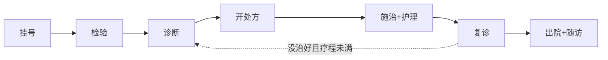

# 代码医院 · 术语手册（用户向）

> 一句话：你把代码送进医院，医院先体检、再诊断、开处方、按方修代码、护士全程盯着防改歪、复查确认治好了才放出院——每一步都有报告。
> 本文是配套术语表，面向**使用者**（不需要读设计文档）。按就医顺序查阅即可。技术契约见 [`code-hospital-design.md`](./code-hospital-design.md) 与 [`code-hospital-io-contracts.md`](./code-hospital-io-contracts.md)。

---

## 一、就医流程术语（按顺序）

| 术语 | 技术名 | 大白话解释 |
|---|---|---|
| **挂号** | `hosp_register` | 告诉医院「治哪里」：整个仓库、某几个文件、还是你刚改的 diff。医院给你建一份**病例**（case），后续所有操作都凭病例号进行。 |
| **分诊** | triage | 挂号时医院判断紧急程度：**急诊**（检出疑似密钥泄露等安全问题，优先只处理安全项）、**门诊**（你指定的范围）、**体检**（全仓库普查）。 |
| **病例查重** | duplicate_cases | 挂号时医院翻档案：「这个病上周来过」——如果相同问题之前治过，会直接告诉你上次的疗效。 |
| **检验** | `hosp_scan` | 扫描师上场：用 ruff、semgrep、gitleaks 等**确定性检查设备**（不是 AI 猜）给代码做体检，产出**检验报告**。只检查，不动代码。 |
| **发现** | finding | 体检查出来的一条问题：什么规则、严重程度、在哪个文件哪一行、证据是什么。每条发现有稳定**指纹**，治好了没、复发了没，都靠指纹对得上。 |
| **诊断** | `hosp_diagnose` | 坐诊师读检验报告：去重归类、分析根因、判断每个病怎么治最划算，产出**诊断书**。还会翻**病史**（这个问题以前治过几次、怎么治的）。 |
| **待复核** | low confidence | 坐诊师对某个归因拿不准（置信度低于 0.5）时会标「待复核」，并**停下来问你**——医院不拿着没把握的诊断直接开药。 |
| **处方** | `hosp_prescribe` | 处方师把诊断书变成一张**有序修复计划**：每味「药」写清改哪个文件、怎么改、改完怎么算合格（验收标准）、改坏了怎么还原（回滚方案）、允许碰哪些文件（范围白名单）。 |
| **审批** | approve | 处方必须批准后才能执行。低风险可自动批；**高风险必须你本人点头**（高危包括：删文件、改鉴权/支付代码、改依赖清单等）。 |
| **剂型** | method | 药的三种形态：**成药**（检查设备自带的一键修复，如 `ruff --fix`，最稳）、**煎药**（AI 现写补丁，药师四道检查后才用）、**外购**（医院治不了，写进转院交接清单建议人工处理）。 |
| **施治** | `hosp_dispense` | 药师按处方抓药、执行修复。**全流程只有这一步会改你的代码**，而且每味药先把补丁存档再应用。 |
| **两步煎药** | need_patch / submit_patch | AI 补丁不是直接糊上去：药师先备好「药引子」（定位内容 + 候选锚点）交给 AI，AI 只需写出替换内容，药师再做格式、锚点、范围、内容四道检查，全部通过才应用。 |
| **护理核查** | nursing | 每服一味药，护理师立刻检查：有没有改到处方范围外（**漂移**）、验收标准过没过。记录随每次施治返回。 |
| **漂移** | drift | AI 顺手改了不该改的文件。护理师发现后**只回滚越界的部分**（已批准的改动不受影响），并把坐诊师叫回来重新评估。 |
| **逆应用回滚** | reverse apply | 回滚不是粗暴地整个文件还原，而是把这味药的那个补丁**反向贴回去**——其他药的合法成果不受影响。 |
| **复诊** | recheck | 药全部服完，再体检一遍，和初诊对比：治好了（resolved）、没变化（unchanged）、**治出来的新病**（医源性新增，重点报警）、检查覆盖差异（不计入疗效）。 |
| **疗程** | round | 一轮「检验→诊断→开方→施治→复诊」。默认最多 3 轮，防止治不好就一直治。到疗程上限会问你：延长还是转院。 |
| **门禁会签** | discharge gate | 出院前的放行检查（不是某个部门，是一条规则）：疗效合格、**没有给仓库其他地方添新病**、测试全绿、病历无未决异常，四项通过才放行。 |
| **豁免（签字强制出院）** | waive | 门禁没通过但你坚持出院——可以，但必须你本人确认并写明理由，记录永久留在病历里（对应真实医院的签字强制出院）。 |
| **出院** | `hosp_discharge` | 产出**出院小结**：疗效判定（**治愈 / 好转 / 未愈 / 转院**）、门禁结论、前后对比、全部报告链接。 |
| **转院** | referred | 医院治不了的（架构问题、需求不清、到疗程上限），出院小结里附**交接清单**：问题在哪、依据是什么、建议怎么处理，交给你人工跟进。 |
| **随访** | follow-up | 出院不失联：小结附**随访计划**——重点盯防的文件清单 + 一段可直接复制的 CI 配置，日后问题复发自动报警；复发再挂号时，查重会调出这次的完整病历。 |
| **会诊转诊单** | referral | 坐诊师发现病根在**另一个仓库**（比如下游服务接口变了），开一张转诊单，你可以拿着它去那个仓库挂个号，两个病例自动关联可查。 |
| **叫号（阶段确认门禁）** | stage gate | 和真实医院一样：每个科室出完产物都会「叫号」——挂号单出来等你确认进诊室，检验报告出来等你确认再诊断，每味药服完等你确认再下一味。**你不确认，流程就停在原地**，绝不会一步到位全弄完。 |
| **绿色通道（全权委托）** | auto_advance | 挂号时声明「全权委托」则免叫号：各阶段自动衔接，一口气跑完。适合 CI 冒烟、一键体检等非交互场景。默认不开启。 |

## 二、你会被问到的时刻（介入节点）

医院每一步都会把产物交给你确认（叫号），在不确定时也**一定会停下来问你**，不会闷头干。你最多会遇到这些问题：

| 什么时候 | 医院问你什么 | 你不回答会怎样 |
|---|---|---|
| **每一步产物产出时** | 「挂号单/检验报告/诊断书/这味药的护理记录，确认无误吗？」 | 流程停在原地等你，无副作用 |
| 挂号范围不明 | 「治哪里？」 | 不建档，等你说 |
| 同仓库已有在治病例 | 「先给旧的出院，还是取消？」 | 取消，不动 |
| 诊断拿不准 | 「这个归因对吗？」 | 这条不进处方（保守） |
| 处方含高危项 | 「这几项风险高，批准吗？」 | 自动降级为「建议人工」，不修 |
| 没找到测试命令 | 「探测到这些命令，可信吗？」 | 跳过测试验收（会在报告里注明） |
| AI 补丁连续失败 | 「这味药煎不出来，跳过/换方/停治？」 | 跳过这味，其他继续 |
| 连续改歪（漂移） | 「已回滚越界改动，停治还是换方？」 | 暂停，等你 |
| 回滚和你的手动修改冲突 | 「需要你整理一下，然后告诉我怎么办」 | 挂起，绝不强行覆盖你的改动 |
| 疗程到了还没好 | 「延长疗程还是转院？」 | 转院，附交接清单 |
| 门禁没过想强行出院 | 「确认豁免？请写理由」 | 按未通过处理 |

## 三、数据与安全（最常问）

| 问题 | 回答 |
|---|---|
| **数据存哪？** | 全部在你仓库的 `.hospital/` 目录（病例库 + 报告 + 补丁存档），默认已加入 `.git/info/exclude`，不污染你的 git 状态。 |
| **要 API Key 吗？** | 主链路不需要。检验、诊断（模板归因）、成药修复全是本地确定性工具；只有「煎药」（AI 补丁）使用你当前 AI 宿主（如 Cursor）的模型能力，不额外要 Key。 |
| **会不会改坏我的代码？** | 四道防线：处方先批准后执行；每味药补丁先存档再应用；护士盯范围，越界即回滚；出院前复查+测试全绿才放行。任何一步不过，改动不会留在你代码里。 |
| **报告里的代码片段安全吗？** | 报告和工具输出中的源码片段按「不可信数据」处理：截断、转义、代码块包裹，防止恶意仓库通过代码注释操纵 AI 行为。 |
| **和 rsi-boot 什么关系？** | 同一作者的姐妹项目（可选联动）：开处方前会查 rsi-boot 记住的项目禁忌（用药禁忌），出院后把治疗经验蒸馏回 rsi-boot（下次同类病直接召回）。不装也能独立用。 |

## 四、黑话翻译速查（给读了设计文档的人）

| 设计黑话 | 翻译 |
|---|---|
| 接力棒（artifact） | 科室之间传递的结构化数据（检验报告、诊断书、处方……），格式定死，下一段只认格式不认人话 |
| 指纹（fingerprint） | 一条发现的稳定身份哈希，跨轮次比对「治好了没/复发了没」靠它 |
| 医源性新增（new_related） | 本次治疗自己引入的新问题，出院门禁重点拦它 |
| 覆盖差异（new_unrelated） | 不是治出来的病，是复查时设备看得更全了；只提示，不算疗效负项（critical 级除外） |
| 四道校验 | 煎药补丁应用前的格式关、锚点关、范围关、内容关 |
| 双通道确认 | 「你本人点头」的两种实现：宿主支持 elicitation 就走系统级弹窗（协议级），不支持就按约定在对话里确认（约定级），病历里会记是哪种 |
| pending_question | 医院停下来问你的统一信号，任何工具都可能返回，回答后从原处继续 |
| pending_gate | 病例正挂起等你的那个「号」：哪个阶段的产物待确认，查病例时能看到 |
| handoff | 每个工具出参末尾的「交接指引」：刚产出什么、下一步去哪个科室、确认后怎么继续 |
| stage_confirmed | 你确认产物后，AI 重新调用下一工具时带的「已确认」通行证参数 |
